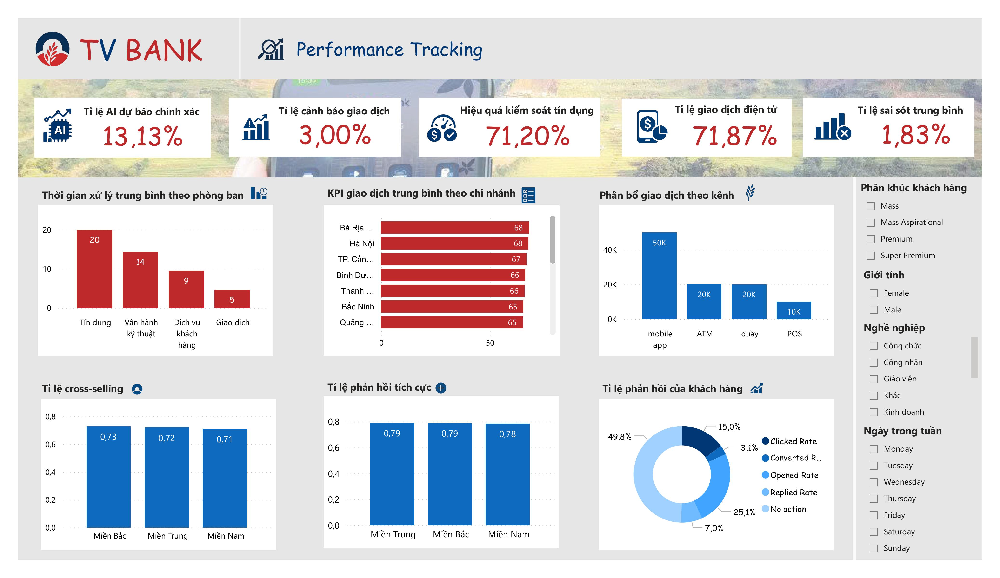

[Tiếng Việt](./README.md) | **English**

# TV Bank Digital Banking Ecosystem Analytics (Power BI - MIS Talent 2025)

Project developed for **MIS Talent 2025** focusing on digital transformation for TV Bank: reducing manual processing bottlenecks (7-10 days), improving cross-selling conversion, and monitoring AI-driven risk control.

* **Dashboard (PDF):** [View Dashboard PDF](./dashboard/Project_MIS_Dashboard.pdf)
* **Synthetic Data Generation (Python):** [View Notebook here](./notebooks/MIS_dataset_generation.ipynb)

---

### 1. Synthetic Dataset & Star Schema Design (Python)
Built a Python script (`pandas`, `numpy`) to generate a relational dataset of **10,000 customers** across 17 provinces, structured into 5 Star Schema tables:
* `MIS_dim_customer.csv` (10,000 rows): Demographics, regions, and 4 customer segments (`Mass` 40%, `Mass Aspirational` 30%, `Premium` 20%, `Super Premium` 10%).
* `dim_employee_ops_cleaned.csv` (238 staff across 17 branches): Tracks monthly KPIs, average handling time, error rates, and satisfaction across 4 departments (`Transactions`, `Credit`, `Customer Service`, `Tech Ops`).
* `fact_service_usage_limited.csv`: Mobile app login frequency (7d/30d), mobile transaction ratios, and customer feedback counts.
* `fact_marketing_crm.csv` (25,000 records): Campaign performance across `SMS`, `Email`, `Chatbot`, and `Telesales` with 5 funnel outcomes.
* `fact_fraud_alerts.csv` (3,000 alerts): AI-predicted risk scores (Beta distribution) and verification results (`confirmed fraud` vs. `false positive`).

---

### 2. Performance Tracking Dashboard (Power BI)

Designed as a concise **Executive One-Pager** tracking core operational, CRM, and AI metrics, with interactive slicers for customer segment, gender, occupation, and day of week.

---

### 3. Key Insights & Recommendations
* **Credit department bottleneck:** The `Credit` department has the longest average handling time (**20 min**), 4x slower than `Transactions` (5 min) and >2x slower than `Customer Service` (9 min). Automating credit scoring with AI is critical to cutting approval turnaround while maintaining a low error rate (1.83%).
* **Strong digital adoption:** Digital transactions account for **71.87%** of total volume, led by the `Mobile App` (**50K** transactions vs. 20K ATM, 20K Branch, and 10K POS).
* **CRM funnel Drop-off:** While `Opened Rate` (25.1%) and `Clicked Rate` (15.0%) show initial engagement, **49.8%** of outreach results in `No action`, leaving the final `Converted Rate` at **3.1%**.
* **AI fraud detection tuning:** Transaction alerts occur at a **3.00%** rate, with an AI precision rate of **13.13%**, indicating room to tune risk score thresholds to reduce false-positive review workloads.
* **Recommendation:** Deploy personalized investment and credit card recommendations targeting high-frequency `Premium` mobile users via `Chatbot` and `Email` instead of traditional `Telesales` to lower acquisition costs and lift Customer Lifetime Value (CLV).
