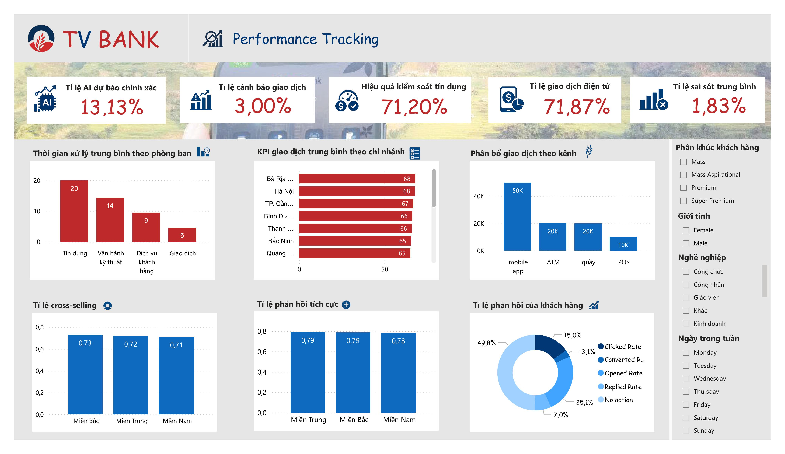

**Tiếng Việt** | [English](./README.en.md)

# Tối ưu hóa hệ sinh thái ngân hàng số TV Bank (Power BI - MIS Talent 2025)

Dự án tham gia cuộc thi **MIS Talent 2025**, tập trung giải quyết bài toán chuyển đổi số cho TV Bank: rút ngắn quy trình vận hành thủ công (đang mất 7-10 ngày), nâng cao tỷ lệ bán chéo (cross-selling) và theo dõi hiệu quả tích hợp AI trong kiểm soát rủi ro.

* **Dashboard (PDF):** [Xem Dashboard tại đây](./dashboard/Project_MIS_Dashboard.pdf)
* **Code sinh dữ liệu giả lập (Python):** [Xem Notebook tại đây](./notebooks/MIS_dataset_generation.ipynb)

---

### 1. Thiết kế bộ dữ liệu & Star Schema (Python)
Tự xây dựng kịch bản sinh dữ liệu bằng Python (`pandas`, `numpy`) cho **10,000 khách hàng** trên 17 tỉnh/thành phố, tổ chức thành 5 bảng chuẩn Star Schema đảm bảo tính toàn vẹn logic:
* `MIS_dim_customer.csv` (10,000 dòng): Thông tin nhân khẩu học, vùng miền và 4 phân khúc khách hàng (`Mass` 40%, `Mass Aspirational` 30%, `Premium` 20%, `Super Premium` 10%).
* `dim_employee_ops_cleaned.csv` (238 nhân sự tại 17 chi nhánh): Theo dõi KPI hàng tháng, thời gian xử lý trung bình, tỷ lệ sai sót và mức độ hài lòng qua 4 phòng ban (`Giao dịch`, `Tín dụng`, `Dịch vụ khách hàng`, `Vận hành kỹ thuật`).
* `fact_service_usage_limited.csv`: Hành vi đăng nhập Mobile App (7 ngày/30 ngày), tỷ lệ giao dịch di động và số lượng phản hồi tích cực/tiêu cực.
* `fact_marketing_crm.csv` (25,000 bản ghi): Hiệu quả chiến dịch qua 4 kênh (`SMS`, `Email`, `Chatbot`, `Telesales`) và 5 trạng thái phễu chuyển đổi.
* `fact_fraud_alerts.csv` (3,000 cảnh báo): Điểm rủi ro gian lận từ AI (phân phối Beta) và kết quả xác minh thực tế (`confirmed fraud` vs. `false positive`).

---

### 2. Dashboard quản trị vận hành (Power BI)

Rút kinh nghiệm từ các dự án trước, toàn bộ chỉ số cốt lõi được tinh gọn trên **1 trang Dashboard duy nhất** (Executive One-Pager) đi kèm bộ lọc tương tác theo phân khúc, giới tính, nghề nghiệp và ngày trong tuần.

---

### 3. Các Insight chính & Đề xuất
* **Điểm nghẽn hiệu suất tại bộ phận Tín dụng:** Thời gian xử lý trung bình của phòng `Tín dụng` cao nhất hệ thống (**20 phút/hồ sơ**), gấp 4 lần bộ phận `Giao dịch` (5 phút) và hơn gấp đôi `Dịch vụ khách hàng` (9 phút). Việc ứng dụng AI chấm điểm tín dụng tự động là đòn bẩy quan trọng để rút ngắn thời gian phê duyệt và giữ tỷ lệ sai sót ở mức thấp (1.83%).
* **Xu hướng dịch chuyển sang kênh số:** Tỷ lệ giao dịch điện tử đạt **71.87%**, trong đó `Mobile App` dẫn đầu tuyệt đối với **50K giao dịch** (vượt xa ATM 20K, Quầy 20K và POS 10K).
* **Hiệu quả phễu Marketing CRM còn thấp:** Dù tỷ lệ mở (`Opened Rate`) đạt **25.1%** và nhấp (`Clicked Rate`) đạt **15.0%**, nhưng gần một nửa khách hàng không tương tác (`No action` **49.8%**) và tỷ lệ chuyển đổi cuối cùng (`Converted Rate`) chỉ dừng ở **3.1%**.
* **Cảnh báo rủi ro AI:** Tỷ lệ cảnh báo giao dịch chiếm **3.00%**, tuy nhiên tỷ lệ AI dự báo chính xác gian lận thực tế mới đạt **13.13%**, cho thấy cần tiếp tục tinh chỉnh ngưỡng điểm rủi ro để giảm tải công việc xác minh thủ công (false positive).
* **Đề xuất:** Tập trung cá nhân hóa gợi ý sản phẩm đầu tư và thẻ tín dụng cho nhóm khách hàng `Premium` (có tần suất dùng app cao) thông qua `Chatbot` và `Email` thay vì `Telesales` truyền thống để vừa tối ưu chi phí, vừa tăng giá trị vòng đời khách hàng (CLV).
